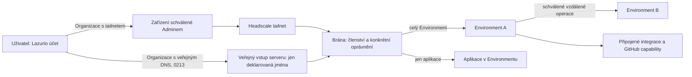

# Účet, zařízení a přístupy k Environmentům

> **GEN4 je autorita.** Veřejný model přístupu drží od 2026-11-01
> LazurioPlatform: [`docs/environment-access.md`](https://github.com/Lazurio/LazurioPlatform/blob/main/docs/environment-access.md),
> rozhodnutí 0192, 0196, 0213 a 0224 jsou ve veřejném rejstříku
> [`docs/decision-register.md`](https://github.com/Lazurio/LazurioPlatform/blob/main/docs/decision-register.md). Tento soubor zůstává
> záznamem GEN3 s podrobnostmi, které do veřejného modelu nepatří.

Rozhodnutí Matěje z 2026-10-06, root decision **0192**, včetně následného
rozhodnutí o vědomém sdílení na základě důvěry. [Architektonické review](environment-access-review-2026-10-06.md)
zachovává nálezy a odlišuje původní doporučení od následné volby Operátora.
Samotný dokument nemění nasazené přihlášení, členství, brány ani
síť. Plánování vlastní DEV-6640, síťovou realizaci DEV-6641 a účty
DEV-6551/DEV-6552 v Mission Controlu Human and Machine. Každý consumer musí
před přechodem doložit níže uvedené chování. Dosavadní GitHub/Team brány
zůstávají označenou migrační implementací, nikoli cílem k další expanzi.

## Uživatel a pracovní schopnosti

Směrem k uživatelům používáme **uživatel**. Uživatel má jeden Lazurio účet s
neměnným identifikátorem issuer + subject. GitHub je volitelná propojená
identita a pracovní schopnost; připojení samo nevytváří repo grant, právo
schválit PR ani právo spravovat Organizaci. Technické názvy dosavadních
GitHub rolí mohou zůstat v kompatibilitních kontraktech; nejsou druhy uživatelů.

Lazurio účet může získat oprávnění k individuálnímu i týmovému pracovnímu
Environmentu bez GitHub účtu. Přihlášení, členství v Organizaci, přidělení
Environmentu a GitHub identita používaná uvnitř jsou odlišné vazby.
Stejný e-mail, login ani zobrazované jméno účty neslučují. Odpojení GitHubu
nepřevádí Environment na jiného uživatele a samo nemaže Lazurio účet.

Pracovní Environment vlastní Organizace; uživateli ho přiděluje. Osobní
Environment a jeho Personalspace zůstávají soukromou hranicí jednoho uživatele.
Plný přístup jiného uživatele k jeho Personalspace se tímto rozhodnutím
nezavádí. Vědomě zpřístupněná aplikace či export nesmí obejít tuto hranici.

## Tři samostatné podmínky vstupu

1. **Síť:** klient používá Tailscale připojený ke správnému Headscale tailnetu
   a konkrétní zařízení schválil Admin. OIDC přihlášení ověří účet, ale samo
   zařízení neschválí. Neschválené, odvolané či nahrazené zařízení nemá
   přístup k chráněným Environmentům ani jejich aplikacím; selhání ověření
   nepovolí dřívější souhlas použít pro jiné zařízení.
2. **Organizace:** uživatel je aktivním členem cílové Organizace v Lazuriu.
   Síťová dosažitelnost ani členství v jiné Organizaci sdílející tailnet
   tuto podmínku nenahrazují.
3. **Cíl:** účet má konkrétní oprávnění k celému Environmentu nebo k určené
   aplikaci. Brána kontroluje rozsah na serverové straně.

Nevzniká veřejná alternativní cesta k pracovnímu Environmentu ani k jeho
aplikacím. Výjimkou je Organizace, která si podle decision 0213 zvolila
veřejné DNS: tam síťová podmínka (bod 1) a schválení zařízení pro lidi
neplatí, lidé vstupují bez tailnetu jen branami Environmentů s přihlášením
Lazurio účtem a každá brána obnovuje relaci nejvýš po dvou minutách; spojení, které
už otevřela, ukončí nejpozději pět minut po otevření, až to T3 Code zvládne (dodatek 0213
z 2026-10-25).
Environmenty zůstávají uzly tailnetu a trezor Organizace zůstává pro lidi jen
v tailnetu. Ostatních Organizací se to netýká. Přihlašovací/control-plane endpoint nutný k založení požadavku na
připojení není přístupem k pracovním datům. Síťová schválení se vážou na
konkrétní identitu zařízení a účet; jejich přesný mechanismus musí prokázat
DEV-6641 na skutečném Headscale. Nová registrace nesmí získat provozní přístup
v mezeře před schválením. SSH ze schváleného zařízení do pracovního
Environmentu, který je přidělený témuž uživateli, je pravidlo: vzniká spolu
se schválením zařízení a při změně přidělení, odvolání zařízení nebo konci
členství se přidá nebo odebere odvozením z téže pravdy, bez další žádosti
(dodatek 0192 z 2026-11-01, HumanAndMachines/Lazurio#652). Opačný směr (Environment →
zařízení) se obecně nedává a jde o samostatné rozhodnutí (0182); jiné SSH
vyžaduje vlastní oprávnění, kromě SSH z Osobního Environmentu do pracovních
Environmentů přidělených témuž uživateli ve stejném tailnetu: i to je pravidlo
a Osobní Environment k němu schválení jako zařízení nepotřebuje (dodatek 0192
z 2026-10-26).

**Schválení zařízení.** Schválení je vztah konkrétního zařízení, účtu jeho
vlastníka a cílové Organizace. Na tailnetu, který obsluhuje víc Organizací,
schvaluje vstup do každé Organizace její Admin; schválení pro jednu Organizaci
neotevře jinou a jedno zařízení může nést schválení pro víc Organizací.
Jednotlivá schválení jsou runtime stav s jediným zapisovatelem: službou na
Conglomerate Hostu, kterou Admin ovládá v Dashboardu (Žádosti o přístup →
Zařízení → Schválit, nebo Odebrat). Služba u každé operace ověří přes GitHub
živou roli Owner volajícího v té Organizaci, zapíše schválení s auditem
a přes API Headscale změní politiku bez restartu; cílem je 30–60 sekund
od kliknutí po dosah i po jeho ztrátu. Své ztracené nebo ukradené zařízení
smí odebrat i sám člověk, hned a bez Admina; schvaluje jen Admin. Pravidla, tedy kdo smí schvalovat
a kam schválené zařízení dosáhne, zůstávají v Deployment Repu vlastníka hostu
a mění se reviewovanou změnou (Plan, Permit, readback). Politiku vykresluje
jeden renderer z těchto pravidel a ze schválení služby; converge Machines
schválení čte, nikdy je nepřepíše. Služba schválení a odebrání automaticky,
bez review, promítá do Deployment Repa jako auditní záznam; projekce je
záznam, ne vstup, a je jedinou výjimkou z pravidla, že se Deployment Repo
mění jen pull requestem (0205 bod 2). Při výpadku služby je záložní cestou reviewovaná změna
v Deployment Repu a služba takové schválení po obnově převezme. Přesun
záznamu do Auth je samostatná migrace bez období dvou zapisovatelů
(dodatek 0192 z 2026-11-01, HumanAndMachines/Lazurio#652).

## Kdo může přístup spravovat

Admin schvaluje členství v Organizaci a přijetí zařízení do její sítě,
přiděluje pracovní Environmenty a spravuje oprávnění napříč uživateli.
Jeho role musí být ověřená; nápis Admin ani přítomnost v tailnetu ji nedává.
Stávající pravidla pro GitHub Owner důkaz při správě zdrojů, releasů a
infrastruktury se tím neruší.

**Členství u účtů s GitHubem.** Členství v Lazurio Organizaci eviduje Auth.
U účtu s propojeným GitHubem ho dál promítá živé členství v GitHub
Organizaci; rozhodnutí z 2026-10-04 platí a Matěj ho 2026-10-06 potvrdil.
Člena bez GitHubu přidá Admin v Dashboardu, až Auth nabídne druhou
přihlašovací metodu (DEV-6551). Nejde o druhý seznam: pro tyto účty je
GitHub vstupem jedné evidence.

Vstup uživatelů do týmového Environmentu spravuje Admin. Do přechodu na granty
Authu ho určuje členství v GitHub Teamu Environmentu jako označená migrační
implementace.

Přidělený uživatel smí v rámci svého oprávnění:

- zpřístupnit svůj pracovní Environment jinému **již aktivnímu členovi téže
  Organizace**, buď celý, nebo jen vybrané aplikace; Environment s daty více
  Organizací celý jen členovi každé z nich (viz níže);
- odvolat takto udělený přístup;
- povolit orientované propojení dvou Environmentů přidělených jemu v téže
  Organizaci, včetně deklarovaného účtu a rozsahu vzdálených operací.

Každé takové sdílení nepotřebuje nové ruční schválení Adminem. Uživatel ale
nemůže pozvat externího uživatele, vytvořit členství, schválit zařízení,
přidělit si cizí Environment nebo obejít organizační hranici. Admin může
propojit Environmenty napříč uživateli v Organizaci. Přidělení dvou
Environmentů z různých Organizací samo nepovoluje propojení jejich dat.
Přeshraniční servisní granty vyžadují vlastní výslovnou autoritu a zachovávají
svůj omezený rozsah; tento model je automaticky nerozšiřuje.

Delegované sdílení celého Environmentu i jednotlivé aplikace se váže na
konkrétní původní přidělení a cílový prostředek. Ztráta nebo změna přidělení,
odebrání členství sdílejícího či příjemce a zrušení nebo převázání cíle tato
sdílení zneplatní; nový přidělený uživatel je nepřebírá a pozdější obnovení
členství je samo neoživí. Nezávislý platný grant zůstává samostatnou cestou
přístupu a Dashboard jej musí ukázat. Přidělení novému uživateli proto nemůže
zpřístupnit jeho nová přihlášení těm, kterým důvěřoval předchozí uživatel.

## Celý Environment, aplikace a vzdálené operace

| Oprávnění | Důsledek |
|---|---|
| Celý Environment | Launchpad, Chat, Automatizace, pracovní soubory a schopnosti dostupné uvnitř. Nejde o izolovaný účet uvnitř sdíleného runtime. |
| Vybraná aplikace | Pouze konkrétní aplikace a její vlastní role. Žádný shell, Chat, Automatizace, jiné aplikace ani přebírání přihlašovacích údajů Environmentu. |
| Environment A → Environment B | Přesně vymezené vzdálené operace; u SSH také cílový OS účet, přihlašovací mechanismus a rozsah. Povolený port sám nestačí. |
| Environment → integrace | Schopnosti připojeného účtu nebo brokeru. Osobní přihlášení návštěvníka se automaticky nevkládá do sdíleného Environmentu. |

Oprávnění k aplikaci musí držet skutečná brána včetně API, WebSocketů,
downloadů a přímých URL; skrytí navigace nestačí. Role uvnitř aplikace a její
datová oprávnění patří aplikaci. Delegované sdílení aplikace dává nejvýše
základní vstup `user`; nepřiděluje `admin` ani oprávnění spravovat další
granty. Přímé základní granty spravuje Admin, aplikační role její vlastní
autorita. Plný přístup k Environmentu není oprávněním
automaticky měnit seznam jeho uživatelů nebo členství Organizace.

Aplikační přístup nikdy nezahrnuje prohlížeč ani plochu Environmentu
(`browser.`, `desktop.`) ani jinou cestu, která ovládá celý Environment.
Sdílená cookie brány z 0191 (8b) není aplikační grant; brána ověřuje každý
cíl zvlášť. Bod 10 rozhodnutí 0191 (vymazat profil prohlížeče před
přeřazením pracovního Environmentu jinému uživateli) platí dál; 0192 ruší jen
povinné odhlašování při běžném sdílení.

### Data Modulů: strop Environmentu a zúžení v aplikaci (0196)

Na data Modulu dosáhne Environment, ne uživatel. Admin Organizace mu dá
přístupy přes jeho kolekci v trezoru Organizace a úložiště je vynucuje; to je
strop Environmentu. Kam tyto přístupy patří, když každé Prostředí má vlastní
trezor a trezor Organizace s jeho kolekcí zaniká, je otevřený bod 8
rozhodnutí 0198. Kdo má celý Environment, pracuje s celým stropem, protože
v Environmentu má root. Kdo má jen aplikaci, vidí část stropu podle pravidel
Organizace: zužuje server Modulu u každého požadavku a víc než strop nedá.

Zúžení je služba provozovatele Environmentu vůči uživatelům, se kterými aplikaci
sdílí, ne izolace proti němu. Provozovatel má root, může server Modulu změnit
a návštěvníkovi ukázat celý strop; Admin Organizace mu proto strop svěřuje
celý a za to, co jeho aplikace ukáže, odpovídá on. Autor změny zapsaný na
Environmentu je informace, ne důkaz proti provozovateli. Kde má zúžení platit
i proti provozovateli, data obsluhuje aplikace provozovaná Organizací, na které
root nemá žádný uživatel, nebo úložiště, které identitu ověřuje samo.

Ověřenou identitu návštěvníka podepisuje Lazurio Auth pro přesný Environment
a aplikaci. Není klíčem k datům: sdílení aplikace nenese práva k datům
návštěvníka a majitel Environmentu, který by identitu návštěvníka zachytil,
nezíská víc než svůj strop. Kdo má vidět data se svými právy, otevře Modul na
svém Environmentu nebo v aplikaci provozované Organizací.

### Plné sdílení individuálního pracovního Environmentu je vědomá důvěra

Přidělený uživatel může důvěryhodnému uživateli udělit plný přístup i tehdy,
když v Environmentu zůstávají jeho osobní pracovní přihlášení. Přijímá
riziko, že příjemce může použít **všechno dostupné uvnitř**: soubory,
procesy, Chat, automatizace, browser a jeho relace, hesla a passkeys,
GitHub i jiné integrace a existující vzdálené přístupy. Systém před
sdílením nevynucuje odhlášení, výmaz profilu, výměnu účtů za broker,
převod na týmový režim ani další schválení Adminem.

Tato volba je pro pomoc uživatele, kterému sdílející důvěřuje. Pro spolupráci
bez takové osobní důvěry slouží samostatný týmový Environment. V obou
případech zůstává povinné členství v Organizaci a v Organizaci s tailnetem i
konkrétní zařízení schválené Adminem (0213); kamarád nebo příbuzný není
výjimkou. Pracovní sdílení
se netýká soukromého Personalspace a nezakládá do něj oprávnění ani nová
propojení. Ručně uložené vzdálené credentials však mohou jeho data technicky
vystavit; zákaz číst cizí Personalspace tím nezaniká a model neslibuje
izolaci libovolných přihlášení uložených uvnitř plně sdíleného runtime.

**Environment s daty více Organizací.** Obsahuje-li individuální pracovní
Environment repozitáře, data nebo přihlášení více Organizací, smí ho
přidělený uživatel plně sdílet jen s uživatelem, který je aktivním členem každé
z nich (rozhodnutí Matěje z 2026-10-06). Organizace připojené do Environmentu
sdílení zkontroluje; že osobní přihlášení, například GitHub, může sahat i do
dalších Organizací, vysvětlí text u sdílení a odpovídá za to sdílející. Jinak
zbývá sdílení vybraných aplikací nebo týmový Environment.
Cílově má GitHub přihlášení v pracovním Environmentu sahat jen do
Organizací tohoto Environmentu, přes OAuth přihlášení bez osobních tokenů
(PAT); mechanismus se teprve ověří, do té doby platí vysvětlení výše.

Dashboard a onboarding vysvětlí rozsah přímo u volby plného přístupu,
bez dalšího schvalovacího workflow. Návrh textu:

> Dáváte tomuto uživateli plný přístup ke všemu v tomto Environmentu, včetně
> souborů, přihlášených účtů a přístupů do dalších služeb a Environmentů.
> Udělte ho jen uživateli, kterému důvěřujete; riziko nesete vy. Pokud jsou tu
> data nebo přihlášení i jiných Organizací, dostane se k nim také, proto ho
> udělte jen členovi všech těchto Organizací. Přístup můžete odebrat, ale již
> získaná data nebo zkopírované přihlašovací údaje tím nezmizí.

Akce „Udělit plný přístup“ je vědomé udělení tohoto rozsahu. „Pouze vybrané
aplikace“ zůstává samostatná skutečně omezená možnost. Žádná nová persona,
bezpečnostní certifikace příjemce nebo povinný režim sdílených credentials
se nezavádí.

Plný vstup nepřidá příjemcovu Lazurio účtu Admin roli. Uložená relace
Admina či jiná privilegovaná identita ale může stejné operace technicky
umožnit; mezi uživateli s plným přístupem k tomuto runtime systém izolaci neslibuje.
Odpovědnost za použití sdílených identit a konkrétní publikační pokyny drží
proces a jmenovaní uživatelé. Udělení vstupu samo není pokyn provést konkrétní
merge, vydání nebo nasazení. Audit odlišuje doložený vstup uživatele od
operace pod účtem dostupným uvnitř; neslibuje jejich nezaměnitelnou shodu.

Odebrání sdílení zavře další vstup a ukončí podporované aktivní relace
podle změřeného kontraktu. Není to vzdálený výmaz kopií ani automatická
revokace všech externích účtů. Při ztrátě důvěry je revokace či rotace
dotčených klíčů a kontrola přetrvávajících změn samostatný recovery krok;
preventivní odhlašování není podmínkou běžného sdílení.

Agent je běh uvnitř Environmentu, nikoli další uživatelská role. Používá
schopnosti tohoto Environmentu. SSH nepředstavuje výhradně agenty a HTTPS
výhradně uživatele: obojí mohou používat uživatelé i automatizace.

Pokud mají další uživatelé plný přístup do A a A může přes SSH ovládat B, získávají
tím nepřímý přístup k B. Dashboard musí při propojení i sdílení ukázat tento
dopad a ověřit oprávnění ke změně příslušného grantu nebo propojení.
Vědomé plné sdílení A zahrnuje jeho již dostupné vzdálené schopnosti;
nevyžaduje nový přímý uživatelský grant do B jen proto, že je B dostupné
zevnitř A. Nevytváří tím novou síťovou hranu, členství, přímý vstup do B
ani cross-organization grant v Auth. Přihlášená integrace však může mít
širší dosah a ten patří k přijatému riziku; nelze slibovat, že ho izoluje
vstupní ACL. Mapa rozliší přímé oprávnění a efektivní cestu přes A.
Audit rozliší doloženého uživatele, zdrojový Environment, cíl a použitou
pracovní identitu; samotná sdílená identita neprokazuje konkrétního uživatele.

## GitHub a publikace

GitHub Team vymezuje repozitářové schopnosti týmového Environmentu, není
povinnou vstupenkou každého jeho uživatele. Lazurio for GitHub je instalace
Organizace; broker omezuje její operace na příslušný Team a repozitáře.

Uživatel bez GitHubu smí přes týmový Environment připravit změnu, vytvořit PR
jeho identitou a použít preview v povoleném rozsahu. GitHub účet není potřeba
k tomu, aby byl autor požadavku auditovatelný jako Lazurio subject.
Schválení a Publikaci provádí jmenovaný uživatel s živým GitHub oprávněním.
Broker, přihlašovací údaje a ochrana větví musí prokazatelně zabránit tomu,
aby sdílený Environment sám provedl merge nebo přímý zápis do chráněné
větve. Bez tohoto důkazu se přístup nové skupině uživatelů nerozšíří.

Tento kontrakt týmové GitHub capability není slib izolace osobní identity
uvnitř vědomě sdíleného individuálního pracovního Environmentu. Tam je
možnost použít uloženou publikační identitu výslovně přijaté riziko a
odpovědnost drží proces. Také v týmovém browseru platí, že dodatečně
vložené osobní přihlášení je dostupné všem uživatelům s plným přístupem; ochrany
organizačního bota samy neomezují práva takto vloženého účtu.

## Přístupy v Conglomerate (0224)

Tato tabulka je jediný výčet přístupů mezi lidmi, zařízeními a Prostředími.
Co v ní není, nevzniká automaticky; to je výjimka z bodu „Výjimky“ níže.

| Přístup | Odkud → kam | Vzniká z | Jak |
|---|---|---|---|
| **Pracovní přístup** | Osobní Prostředí → Pracovní Prostředí přidělená jeho Ownerovi ve všech Organizacích jeho Conglomerate | přidělení Prostředí a živé členství | automaticky, SSH, jen tímto směrem |
| **Týmová Prostředí přes Pracovní** | Pracovní Prostředí člověka → Týmová Prostředí jeho Teamů v téže Organizaci | členství v Teamu | automaticky, SSH klíčem Pracovního Prostředí; z Osobního Prostředí dvěma kroky: `ssh` do vlastního Pracovního Prostředí a odtud druhé `ssh`, nikdy napřímo |
| **Správcovský přístup** (0202) | Pracovní Prostředí Admina → všechna ostatní Prostředí jeho Organizace (Pracovní, Týmová, Henry, Služby serveru) | živá role Admina | automaticky, SSH klíčem Pracovního Prostředí Admina; z Osobního Prostředí Admina stejně dvěma kroky přes jeho Pracovní |
| **Přístup ze zařízení** | schválené zařízení člověka → jeho Prostředí | schválení zařízení Adminem (dodatek 0192 z 2026-11-01) | automaticky po schválení, 443 a 22, telefon 443 |
| **Přístup na zařízení** | Prostředí → konkrétní počítač (vlastní laptop, pracovní stanice Organizace) | souhlas Ownera zařízení: osobní počítač jeho člověk, počítač Organizace její Admin s výběrem Prostředí | volitelně, pro každé zařízení zvlášť, odvolatelně, SSH |
| **Výjimky** | cokoli jiného | reviewovaný PR do Deployment Repa s důvodem a ownerem | výjimečně |

Žádná hrana nevzniká jako opačný směr jiné: Pracovní → Osobní ani Týmové →
Pracovní nevznikají a cíl Správcovského přístupu tím na Prostředí Admina
nedosáhne. Pracovní Prostředí jiného Admina téže Organizace je cílem
Správcovského přístupu jako každé jiné; dva Admini tak dosáhnou jeden na
druhého, každý ze své role. Klíč zdrojového Prostředí se nepřeposílá
a nikam dál nevede: krok z Pracovního do Týmového Prostředí dělá druhý
`ssh` spuštěný v Pracovním Prostředí s jeho vlastním klíčem. Produkt 1 bez
tailnetu (0207) tyto přístupy nemá.

**Kdo přístup uděluje.** Admin Organizace svými rozhodnutími: přidělí
Prostředí, zařadí člověka do Teamu, jmenuje Admina, schválí zařízení. Vstup
Organizace do Conglomerate je souhlas jejího Admina s Pracovním přístupem
členů a s osobním kontextem níže. Zvláštní SSH grant se nezakládá.

**Jak vzniká.** Fakta průběžně převádí služba na Conglomerate Hostu, tatáž,
která schvaluje zařízení. Mění politiku Headscale bez restartu, doručí klíč
zdrojového Prostředí do cílového účtu (`from=` adresa zdroje, bez
přeposílání), dá zdrojovému Prostředí seznam cílů s pinnutými klíči
hostitele a vede audit s projekcí do Deployment Repa bez review. Pravidla
zůstávají v Gitu a mění se PR. Po odebrání faktu zmizí pravidlo i klíč do
5 minut. Nová spojení pak selžou a běžící relace smějí doběhnout.

**Jak to agenti vědí.** Osobní Prostředí má od Lazuria seznam svých cílů
a výsledek posledního ověření (`ssh <id Prostředí> true`). Onboarding
i doctor každou cestu vyzkouší a chybějící cesta k přidělenému Pracovnímu
Prostředí je nedokončený onboarding. Buddy a agenti nepoužívají ruční
aliasy. Když cesta chybí, řeknou to.

**Data v osobním kontextu.** Conglomerate sdružuje spřátelené Organizace
a Osobní Prostředí patří právě jednomu. V osobním kontextu se data těchto
Organizací smějí potkat, protože se potkávají v člověku, který je členem
každé z nich, a Buddy z nich smí skládat výstupy pro svého uživatele.
V kontextu Organizace se data nemíchají a z Osobního Prostředí se nic
nepřenáší do jiné Organizace. Každá Organizace má vlastní server jen se
svými Prostředími; Osobní Prostředí sdílejí server poolu, pod Conglomeráty
odděleně od Osobních Prostředí bez tailnetu.

## Autority a mapa Conglomerate

| Pravda | Vlastník |
|---|---|
| Lazurio účty, propojené identity, členství a oprávnění ke vstupu | Auth na standardním identity provideru; Dashboard je spravuje, nevytváří druhý seznam ACL. |
| Technická existence, vlastník a nasazené verze Environmentu; konfigurace a důkazy sítě | Deployment Repo vlastníka a řízený apply Machines. |
| Schválení zařízení pro Organizaci (jen Organizace s tailnetem; u Organizace s veřejným DNS podle 0213 se zařízení neschvalují) | Jednotlivá schválení: služba na Conglomerate Hostu jako jediný zapisovatel, ovládaná Adminem z Dashboardu (své zařízení smí odebrat i sám člověk), s auditem a automatickou projekcí do Deployment Repa bez review; pravidla schvalování a dosahu: Deployment Repo vlastníka hostu a řízený apply Machines; cílově Auth spravovaný z Dashboardu (dodatek 0192 z 2026-11-01, HumanAndMachines/Lazurio#652). |
| Přidělení uživatele a delegované sdílení | Jeden autoritativní account/access kontrakt Auth spravovaný přes Dashboard. Dosavadní infra assignment je migrační vstup, ne druhý nezávislý writer. |
| Repozitáře, Team capability, schválení PR a branch rules | GitHub. |
| Tajné hodnoty | Příslušný trezor/custody; ostatní vrstvy drží reference. |
| Zobrazení vztahů a stavu | Dashboard, odvozeně z oprávnění, deklarací, evidence apply a čerstvého hlášení hostu. |

Mapa má vrstvy **Uživatelé → Zařízení → Environmenty → Připojené aplikace**,
seskupené po Organizacích. U Organizace s veřejným DNS (0213) vrstva zařízení
chybí: síťová větev vede přes veřejný vstup serveru místo schváleného zařízení
a tailnetu, členství a konkrétní grant u brány zůstávají společné. Rozlišuje plný a aplikační přístup, směrové
Environment-to-Environment operace, přidělení a vlastnictví. Ukazuje také
čekající schválení, požadovaný, nasazený, živý a odvolávaný stav. Není novou
autoritou. Uživatel bez GitHubu smí vidět své autorizované prostředky bez
práva číst celý infra repozitář; backend poskytne jen příslušnou projekci.
Celou mapu Organizace vidí její Admin (dnes ověřený živý GitHub Owner);
uživatel vidí svá zařízení a prostředky, ke kterým má přístup (rozhodnutí
Matěje z 2026-10-06 večer v DEV-6640).

Síťová pravidla jsou odvozený nasazený výstup schválené politiky a konkrétního
zařízení. Výjimkou jsou přístupy mezi Prostředími a na zařízení z oddílu
Přístupy v Conglomerate (0224): Osobní Prostředí není zařízení a jeho
Pracovní přístup se odvozuje z přidělení Pracovního Prostředí a živého
členství, bez schválení zařízení. Diagram výše ukazuje vstup lidí a jejich
zařízení, ne úplný model zdrojů SSH. Každá SSH hrana mezi Prostředími má
kromě grantu v síti i klíč zdrojového Prostředí, který cíl přijímá jen
z adresy zdroje (`from=`), jen k přidělenému účtu a bez přeposílání, a který
se přidá a odebere se stejným přidělením nebo rolí; chyba v síťových
pravidlech tak sama SSH neotevře.
Změny infrastruktury dál používají řízené plánování, apply a evidenci;
Dashboard nesmí obejít tyto kontroly přímým zápisem do Headscale. Výjimkou
jsou jednotlivá schválení zařízení (dodatek 0192 z 2026-11-01,
HumanAndMachines/Lazurio#652) a přístupy odvozené z faktů podle 0224: obojí
jde přes službu na Conglomerate Hostu podle pravidel z Deployment Repa. To neznamená nutnost osobního GitHub účtu nebo dalšího
kliknutí Admina pro každé dovolené interní sdílení. Servisní vykonavatel smí
mít jen rozsah schválené operace a nesmí vytvářet vlastní přístupovou
autoritu.

## Přechod a ověření

Rozhodnutí nahrazuje v cílovém modelu 0184 a DEV-6641 vazbu identity na
GitHub ID, automatické schválení zařízení a O10 jako dostatečnou vstupní
politiku. Nahrazuje také výklad 0183/DEV-6640, že každé uživatelské sdílení
musí být ruční PR a viditelnost mapy vyžaduje osobní read grant do infra.
GitHub ID se zachová jako ověřený link a migrační důkaz. Existující DNS
slugs, adresy, klíče ani servisní granty se bez přesného plánu nepřepisují.
Existujícímu přístupu bez doložené vazby na přidělení se při migraci nevymyslí
původ delegovaného sdílení. Zachová se jeho skutečný správcovský/servisní
původ, přesný rozsah a ověřená autorita; nejasné případy vyřeší migrační plán.

Před realizací své části musí owning repa prokázat to, co jim z tohoto
seznamu přísluší: uživatele bez GitHubu; nové a odvolané zařízení; plný
versus aplikační přístup; zákaz externího pozvání; sdílení uvnitř Organizace
bez dalšího Admin kroku; propojení vlastních a cizích Environmentů včetně
nepřímého přístupu; PR/preview bez publikace; bezpečné přepřidělení včetně
starých relací a credentials; odmítnutí při výpadku autority a odvolání
členství/přístupu. Odvolání musí mít změřené chování i pro existující
browser, WebSocket a SSH relace. Žádný konkrétní čas ani okamžitá revokace
nejsou tímto textem vydávanou zárukou.

DEV-6640 drží společný kontrakt a mapu; DEV-6551 Auth autoritu,
DEV-6552 přihlášení Dashboardu, DEV-6638 registraci a přidělení,
DEV-6639 seznam a shell, DEV-6644 onboarding a DEV-6645 ovládání Dashboardu.
Dřívější úspěšné testy GitHub-only admission dokazují pouze starý kontrakt.
Tato dokumentační změna nespouští rollout ani nezve žádného uživatele do
skutečné sítě.

DEV-6641 dodává síťovou část ve všech tailnetech, nejdřív ve sdíleném
tailnetu, který obsluhuje víc Organizací. Uživatel zařízení zaregistruje
přihlášením do tailnetu Lazurio účtem (Headscale OIDC); zařízení přistane pod
jeho osobním Headscale userem s identitou Lazurio subject a nemá žádný dosah.
Admin každé Organizace schválí konkrétní zařízení. Schválené zařízení dostane
HTTPS a privátní DNS k Environmentům svých schválených Organizací a o vstupu
dál rozhoduje brána Environmentu. Laptop člověka dosáhne do všech jeho
vlastních Environmentů na HTTPS 443 i SSH 22, telefon jen na 443, dokud ho
aplikace nepotřebuje na 22 (dodatek 0192 z 2026-11-01,
HumanAndMachines/Lazurio#652). SSH zůstává u přesných grantů: zařízení →
Environment přidělený témuž uživateli vzniká spolu se schválením zařízení a sleduje
změny přidělení a členství (dodatek 0192 z 2026-10-07), ostatní jen výslovně (SSH z Osobního
Environmentu upravuje dodatek 0192 z 2026-10-26), a
stávající zařízení se převedou bez nového přihlášení. Vstupní granty brány
(přidělení, plné a aplikační sdílení, vstup bez GitHubu) patří do
DEV-6551/6552/6638/6645; do jejich nasazení brány pouští podle GitHub Teamu
jako označená migrační implementace. Matěj 2026-10-06 večer rozhodl, že se
uživatelé připojí rovnou touto cílovou cestou, bez dočasné registrace přes
předávaný odkaz.
